# Comanche055 — Legacy-Architekturbeschreibung

> **Quelle**: `input/virtualagc/Comanche055/` und `input/Apollo-11/Comanche055/`  
> **Programm**: Colossus 2A, Revision 055 — AGC-Firmware des Command Module, Apollo 11  
> **Erstellt**: MIT im Auftrag der NASA, 1. April 1969 (NAS 9-4065)

---

## Überblick

Comanche055 ist eine **monolithische Firmware** ohne Linker und ohne Betriebssystem im modernen Sinne. Der gesamte Code wird vom Assembler `yaYUL` in einem einzigen Pass zusammengebaut — [`MAIN.agc`](../input/virtualagc/Comanche055/MAIN.agc) bindet alle anderen Dateien per `$INCLUDE` ein. Es gibt keine getrennte Link-Phase; die Modul-Grenzen existieren nur als logische Gliederung der Quelldateien.

Der Code gliedert sich in **sechs Segmente**, die im Original als `COMERASE`, `COMAID`, `COMEKISS`, `TROUBLE`, `TVCDAPS` und `CHIEFTAN` bezeichnet werden (definiert in [`ASSEMBLY_AND_OPERATION_INFORMATION.agc`](../input/virtualagc/Comanche055/ASSEMBLY_AND_OPERATION_INFORMATION.agc)).

---

## Segmentübersicht

| Segment | Dateien (pp.) | Inhalt |
|---|---|---|
| **COMERASE** | pp. 37–130 | Erasable-Memory-Layout — alle Variablen und Register |
| **COMAID** | pp. 131–455 | I/O, DSKY, IMU, Interrupt-Handler, Restart-Infrastruktur |
| **COMEKISS** | pp. 456–532 | Navigationsmessungen, stabile Umlaufbahn, Rendezvous-Vorbereitung |
| **TROUBLE** | pp. 533–936 | Die eigentlichen Missionsprogramme P11–P70, Re-Entry |
| **TVCDAPS** | pp. 937–1092 | TVC (Triebwerks-Vektorkontrolle) + RCS Digital Autopilot |
| **CHIEFTAN** | pp. 1093–1516 | Kern-Runtime: Executive, Waitlist, Interpreter, Navigationsmathematik |

---

## Komponentendiagramm

```mermaid
graph TB
    subgraph HW["Hardware-Schnittstellen (I/O Channels)"]
        IMU["IMU\n(Trägheitsplattform)"]
        DSKY["DSKY\n(Display & Keyboard)"]
        CDU["CDU\n(Coupling Data Units)"]
        RADAR["Radar /\nSextant"]
        RCS["RCS Triebwerke"]
        SPS["SPS / TVC\n(Haupttriebwerk)"]
        TELEM["Telemetrie\n(Down/Uplink)"]
    end

    subgraph COMAID["COMAID — I/O & Infrastruktur"]
        direction TB
        RUPT["Interrupt Lead-Ins\nT3/T4/T5/T6/KEY/UP/DOWN/RADAR"]
        T4RUPT["T4RUPT (10 ms Tick)\nIMU-Abfrage, RCS-Pulse, Display-Refresh"]
        PINBALL["PINBALL\n(DSKY Buttons & Lights\nVerb/Noun-Tabellen)"]
        IMUCOMP["IMU Compensation\n& Alignment"]
        DOWNLINK["Down-Telemetry\n& Uplink"]
        FRESHSTART["Fresh Start &\nRestart-Handler"]
        PHASETAB["Phase Table\nMaintenance\n(Restart Safety)"]
    end

    subgraph CHIEFTAN["CHIEFTAN — Kern-Runtime"]
        direction TB
        EXEC["Executive\n(kooperativer Job-Scheduler\nPrioritäten 0–31)"]
        WAITLIST["Waitlist\n(zeitgesteuerte Tasks\nvia T3RUPT)"]
        INTERP["Interpreter\n(Bytecode-VM\nVLOAD/STORE/DOT/…)"]
        ALARM["Alarm & Abort\nGOJAM / Program Alarm"]
    end

    subgraph NAVMATH["CHIEFTAN — Navigationsmathematik"]
        direction TB
        CONIC["Conic Subroutines\n(Kepler, Lambert,\nOrbit-Lösungen)"]
        ORBINT["Orbital Integration\n(Zustandsvektor-Propagation)"]
        INCORP["Measurement Incorporation\n(Kalman-Filter / W-Matrix)"]
        PLANET["Planetary Inertial\nOrientation\n(Mond/Erde-Ephemeriden)"]
        LATLON["Lat/Lon Subroutines"]
        POWERED["Powered Flight\nSubroutines\n(Δv, Burn-Zeit)"]
        TOFF["Time of Free Fall"]
        STARS["Star Tables"]
        ALIGN["Inflight Alignment\n(IMU-Sternmessung)"]
    end

    subgraph COMEKISS["COMEKISS — Rendezvous & Orbit"]
        P20_25["P20–P25\nRendezvous Navigation"]
        P30_37["P30, P37\nMid-Course Correction\nReturn-to-Earth"]
        P32_33["P32–P33, P72–P73\nRendezvous Manöver"]
        P38_39["P38–P39\nStabile Umlaufbahn"]
        R30_31["R30, R31\nOrbital-Parameter\nAnzeige"]
    end

    subgraph TROUBLE["TROUBLE — Missionsprogramme"]
        direction TB
        P11["P11 Earth Orbit\nInsertion"]
        P40_47["P40–P47\nSPS Burn,\nGimbal Test"]
        P51_53["P51–P53\nIMU-Alignment\n(Sternnavigation)"]
        P61_67["P61–P67\nEntry Programs\n(Reentry)"]
        P37_70["P37, P70\nReturn to Earth\nEmergency Return"]
        REENTRY["Reentry Control\n& Entry DAP"]
        SXTMARK["SXTMARK\n(Sextanten-Messung)"]
    end

    subgraph TVCDAPS["TVCDAPS — Lageregelung"]
        TVC["TVC DAP\n(Triebwerks-Vektorsteuerung\nPitch/Yaw)"]
        TVCROLL["TVC Roll DAP"]
        RCS_DAP["RCS-CSM DAP\n(Reaktionskontrolle)"]
        JET["Jet Selection Logic\n(Thruster-Paare)"]
        KALMANU["KALCMANU Steering\n(Attitude Manöver)"]
        AUTOMAN["Automatic Maneuvers"]
        GIMBAL["Gimbal Lock\nAvoidance"]
    end

    subgraph ERASABLE["COMERASE — Erasable Memory (RAM ~2 k Wörter)"]
        STATE["Zustandsvektor\n(RCV, VCV)"]
        FLAGS["Flags & Mode-Register\n(MODREG, Phase Table)"]
        BUFS["Display-Buffer\nDSKY-Puffer"]
        LSTTASK["LST1/LST2\n(Waitlist-Tabellen)"]
        VACTAB["VAC-Areas\n(Interpreter-Arbeitspeicher)"]
    end

    %% Hardware → Interrupts
    IMU -->|"PIPA-Pulse\n(CDU-Δθ)"| T4RUPT
    DSKY -->|"KEYRUPT1/2"| PINBALL
    RADAR -->|"RADAR RUPT"| COMEKISS
    TELEM -->|"UPRUPT"| DOWNLINK

    %% Interrupt-Handler → Executive
    RUPT --> EXEC
    T4RUPT --> EXEC
    T4RUPT --> WAITLIST

    %% Runtime-Kern
    EXEC -->|"Jobs verwalten"| WAITLIST
    EXEC -->|"Interpreter-Jobs"| INTERP
    INTERP -->|"nutzt"| NAVMATH
    ALARM -->|"GOJAM"| FRESHSTART
    PHASETAB -->|"Restart-Kontext"| FRESHSTART

    %% Executive → Missionsprogramme
    EXEC --> COMEKISS
    EXEC --> TROUBLE
    EXEC --> TVCDAPS

    %% Navigationsmathematik ↔ State
    NAVMATH <-->|"liest/schreibt"| STATE
    INCORP -->|"Zustandskorrektur"| STATE
    ORBINT -->|"Propagation"| STATE

    %% Missionsprogramme → DAP
    TROUBLE --> TVCDAPS
    COMEKISS --> NAVMATH

    %% DAP → Hardware
    TVC -->|"Gimbal-Befehle"| SPS
    RCS_DAP -->|"Jet-Pulse"| RCS
    JET --> RCS

    %% Display
    PINBALL <-->|"Verb/Noun"| BUFS
    TROUBLE -->|"V/N-Displays"| PINBALL
    COMEKISS -->|"V/N-Displays"| PINBALL

    %% Shared Memory
    EXEC <-->|"nutzt"| ERASABLE
    WAITLIST <-->|"LST1/LST2"| LSTTASK
    INTERP <-->|"VAC"| VACTAB

    style CHIEFTAN fill:#1a3a5c,color:#fff
    style NAVMATH fill:#1a3a5c,color:#fff
    style COMAID fill:#2d5a27,color:#fff
    style TROUBLE fill:#5c3a1a,color:#fff
    style COMEKISS fill:#5c3a1a,color:#fff
    style TVCDAPS fill:#4a1a5c,color:#fff
    style ERASABLE fill:#3a3a3a,color:#fff
    style HW fill:#1a4a4a,color:#fff
```

---

## Schichten im Detail

### 1. Hardware-Schnittstellen (I/O Channels)

Der AGC kommuniziert ausschließlich über **I/O-Kanalregister** — es gibt keine Memory-Mapped-Peripherie. Alle Schnittstellen zu IMU, DSKY, Triebwerken und Telemetrie laufen über dedizierte Kanalnummern.

Quellen: [`INTERRUPT_LEAD_INS.agc`](../input/virtualagc/Comanche055/INTERRUPT_LEAD_INS.agc)

| Interrupt | Auslöser | Periode |
|---|---|---|
| T3RUPT | Timer 3 | Waitlist-Tick |
| T4RUPT | Timer 4 | 10 ms — IMU, Display, RCS |
| T5RUPT | Timer 5 | variabel |
| T6RUPT | Timer 6 | CDU-Nullstellen |
| KEYRUPT1/2 | DSKY-Tastendruck | asynchron |
| UPRUPT | Uplink-Daten | asynchron |
| DOWNRUPT | Downlink-Trigger | asynchron |
| RADAR RUPT | Radar-Datenwort fertig | asynchron |

---

### 2. COMAID — Interrupt-Handler & Infrastruktur

Das **Herz der Echtzeit-Reaktion**. Zentrale Komponente ist der **T4RUPT** (alle 10 ms), der:
- IMU-CDU-Winkelinkremente liest (PIPA-Pulse),
- den Display-Refresh des DSKY antreibt,
- RCS-Jet-Pulse auslöst,
- Waitlist-Tasks feuert.

Die **Phase Table** ([`PHASE_TABLE_MAINTENANCE.agc`](../input/virtualagc/Comanche055/PHASE_TABLE_MAINTENANCE.agc)) ist der Checkpoint-Mechanismus des AGC: Vor jedem kritischen Schritt einer mehrstufigen Berechnung wird der Fortschritt in die Phase Table geschrieben. Nach einem GOJAM/Neustart liest [`FRESH_START_AND_RESTART.agc`](../input/virtualagc/Comanche055/FRESH_START_AND_RESTART.agc) die Phase Table und setzt an der letzten gesicherten Stelle fort.

**PINBALL** ([`PINBALL_GAME__BUTTONS_AND_LIGHTS.agc`](../input/virtualagc/Comanche055/PINBALL_GAME__BUTTONS_AND_LIGHTS.agc)) implementiert das gesamte DSKY-Protokoll: Verb/Noun-Eingabe, Register-Anzeige (R1/R2/R3), Programm-Alarmlampen und die Interaktion zwischen Astronaut und laufendem Programm.

---

### 3. CHIEFTAN — Executive & Waitlist (Scheduler)

Quellen: [`EXECUTIVE.agc`](../input/virtualagc/Comanche055/EXECUTIVE.agc), [`WAITLIST.agc`](../input/virtualagc/Comanche055/WAITLIST.agc)

Der **Executive** ist ein kooperativer Scheduler ohne Preemption:
- **Prioritäten 0–31**: höhere Zahl = höhere Priorität.
- Jobs werden mit `NOVAC` (kein Vektorarbeitsbereich nötig) oder `FINDVAC` (benötigt VAC-Area für Interpreter) angemeldet.
- Kein Job darf blockieren oder spinnen. Lange Berechnungen werden in Phasen aufgeteilt.

Die **Waitlist** verwaltet bis zu 9 zeitlich verzögerte Tasks (in Zentisekunden). Sie nutzt zwei Listen (`LST1`, `LST2`) und wird über T3RUPT getaktet.

---

### 4. CHIEFTAN — Interpreter (Bytecode-VM)

Quelle: [`INTERPRETER.agc`](../input/virtualagc/Comanche055/INTERPRETER.agc) (pp. 1107–1199, ~92 Seiten — die größte Einzeldatei)

Der Interpreter ist eine **Stack-basierte Bytecode-VM** für Vektor- und Skalarmathematik. Er wurde eingesetzt, weil AGC-Maschinencode für Vektoroperationen sehr viel Speicher kostet — der Interpreter ermöglicht kompaktere Darstellung durch pseudo-Instruktionen wie `VLOAD`, `STORE`, `DOT`, `UNIT`, `SQRT`, `DLOAD`, `TLOAD`.

> **Rust-Implementierung**: Die VM selbst wird **nicht** nachgebaut. Jede Routine, die im Original in Interpreter-Code geschrieben ist, wird als native `f64`-Rust-Funktion reimplementiert. Der [`input/AGC Symbolic Listing.md`](../input/AGC%20Symbolic%20Listing.md) erklärt die Semantik der Interpreter-Opcodes.

---

### 5. CHIEFTAN — Navigationsmathematik

Die mathematische Kernschicht. Alle Routinen laufen als Interpreter-Jobs unter dem Executive.

| Datei | Inhalt |
|---|---|
| [`CONIC_SUBROUTINES.agc`](../input/virtualagc/Comanche055/CONIC_SUBROUTINES.agc) | Zwei-Körper-Problem: Kepler-Gleichung, Lambert-Problem, Orbit-Parameter aus r/v |
| [`ORBITAL_INTEGRATION.agc`](../input/virtualagc/Comanche055/ORBITAL_INTEGRATION.agc) | Zustandsvektor-Propagation mit Störtermen (Mond, Abplattung) |
| [`MEASUREMENT_INCORPORATION.agc`](../input/virtualagc/Comanche055/MEASUREMENT_INCORPORATION.agc) | Kalman-artiger Filter: misst Abweichung, gewichtet mit W-Matrix (6D oder 9D) |
| [`PLANETARY_INERTIAL_ORIENTATION.agc`](../input/virtualagc/Comanche055/PLANETARY_INERTIAL_ORIENTATION.agc) | Mond- und Erd-Ephemeriden, Koordinatentransformationen |
| [`INFLIGHT_ALIGNMENT_ROUTINES.agc`](../input/virtualagc/Comanche055/INFLIGHT_ALIGNMENT_ROUTINES.agc) | IMU-Neuausrichtung anhand von Sternmessungen (TRIAD/QUEST) |
| [`POWERED_FLIGHT_SUBROUTINES.agc`](../input/virtualagc/Comanche055/POWERED_FLIGHT_SUBROUTINES.agc) | Δv-Berechnung, Brennzeit, Cutoff-Kriterien |
| [`TIME_OF_FREE_FALL.agc`](../input/virtualagc/Comanche055/TIME_OF_FREE_FALL.agc) | Flugzeit-Berechnungen auf Kegelschnitt-Bahn |
| [`LATITUDE_LONGITUDE_SUBROUTINES.agc`](../input/virtualagc/Comanche055/LATITUDE_LONGITUDE_SUBROUTINES.agc) | Geographische Koordinaten aus Zustandsvektor |
| [`STAR_TABLES.agc`](../input/virtualagc/Comanche055/STAR_TABLES.agc) | 37 Navigationssterne mit Einheitsvektoren (J2000) |

---

### 6. COMEKISS — Rendezvous & Orbit-Programme

Navigationsprogramme für die Missions-Phasen vor der Mondlandung und nach der Rendezvous-Vorbereitung:

| Programm | Funktion |
|---|---|
| P20–P25 | Rendezvous-Navigation (Radar-Tracking, Winkelbestimmung) |
| P30, P37 | Mid-Course Corrections, Return-to-Earth-Trajektorie |
| P32–P33, P72–P73 | Rendezvous-Manöver (CDH, TPI) |
| P38–P39 | Stabile Umlaufbahn halten |
| R30, R31 | Anzeige orbitaler Parameter |
| P76 | TPI-Ziel-Update |
| P21 | Bodentrack-Bestimmung |

---

### 7. TROUBLE — Missionsprogramme

Die eigentlichen **Guidance Programs** für alle kritischen Missionsabschnitte:

| Programm | Phase | Funktion |
|---|---|---|
| P11 | TLI/Earth-Orbit | Earth Orbit Insertion Überwachung |
| P40–P47 | Powered Flight | SPS-Burn-Sequenz, Gimbal-Test, Cutoff |
| P51–P53 | Alignment | IMU-Alignment via Sternmessung (P51: Initial, P52: Realign, P53: Confirm) |
| P61–P67 | Entry | Reentry-Steuerung, Entry-Monitore, Landezone-Berechnung |
| P37, P70 | Abort | Return-to-Earth-Trajektorie, Notfall-Rückkehr |
| REENTRY CONTROL | Entry DAP | Closed-Loop-Steuerung während atmosphärischer Eintritt |
| SXTMARK | Optik | Sextanten-Messung für Navigationsfix |

---

### 8. TVCDAPS — Digitale Autopiloten

Quelle: [`TVCDAPS.agc`](../input/virtualagc/Comanche055/TVCDAPS.agc), [`RCS-CSM_DIGITAL_AUTOPILOT.agc`](../input/virtualagc/Comanche055/RCS-CSM_DIGITAL_AUTOPILOT.agc)

**TVC-DAP** (Thrust Vector Control Digital Autopilot):
- Steuert die Schwenkdüsen des SPS-Haupttriebwerks (Pitch und Yaw).
- Verwendet eine PID-ähnliche Regelung mit Massenträgheitsmodell (`TVCMASSPROP.agc`).
- `TVCROLLDAP.agc` übernimmt die Roll-Achse separat (via RCS).

**RCS-CSM DAP**:
- Lagesteuerung mit den 16 Reaktionskontroll-Triebwerken (vier Quad-Gruppen à vier Düsen).
- `JET_SELECTION_LOGIC.agc`: Mappt gewünschte Drehmomente auf konkrete Thruster-Paare (Minimum-Fuel-Auswahl).
- `KALCMANU_STEERING.agc`: Berechnet optimale Schwenksequenzen unter Gimballock-Vermeidung.
- `GIMBAL_LOCK_AVOIDANCE.agc`: Sperrt Manöver, die den mittleren Gimbal über ±70° führen würden.

---

### 9. Alarm- und Restart-Mechanismus

Quelle: [`ALARM_AND_ABORT.agc`](../input/virtualagc/Comanche055/ALARM_AND_ABORT.agc), [`RESTARTS_ROUTINE.agc`](../input/virtualagc/Comanche055/RESTARTS_ROUTINE.agc)

| Zustand | Auslöser | Konsequenz |
|---|---|---|
| **Program Alarm** | `TC ALARM` | Alarmlampe an, Anzeige des Codes, kein Neustart |
| **ABORT** | `TC ABORT` | Sofortiger Neustart (GOJAM), Phase Table wird ausgewertet |
| **GOJAM** | Hardware-Watchdog oder `ABORT` | Vollständiger Neustart, Zustand aus Phase Table restauriert |
| **Fresh Start** | Astronaut (V36E) oder Power-On | Vollständiger Neustart, Phase Table wird gelöscht |

---

## Speicherstruktur

Der AGC Block II hat zwei Speichertypen:

| Typ | Größe | Inhalt |
|---|---|---|
| **Erasable Memory** (RAM) | ~2 048 Wörter à 15 bit | Variablen, Zustandsvektor, Flags, Waitlist, VAC-Areas |
| **Fixed Memory** (ROM) | ~36 864 Wörter à 15 bit | Programmcode, Konstanten, Star Tables |

Das Erasable Memory ist in **Banks** eingeteilt (E0–E7). Jedes Modul deklariert mit `EBANK=` welche Bank es benötigt. Gleichzeitiger Zugriff auf zwei verschiedene Banks ist nicht möglich — ein Constraint, der bei der Rust-Implementierung durch die statische Datenstruktur-Aufteilung berücksichtigt werden muss.

---

## Hinweise zur Rust-Reimplementierung

| AGC-Konzept | Rust-Äquivalent |
|---|---|
| Executive (Job-Scheduler) | Statische Prioritäts-Queue, `no_std`, kein Heap |
| Waitlist | Statisches Array von `(deadline: u32, task: fn())`, max. 9 Einträge |
| Phase Table | Statische Enum-Tabelle pro Gruppe; vor jedem kritischen Schritt schreiben |
| Interpreter-Opcodes | Native `f64`-Rust-Funktionen (keine VM) |
| Erasable-Bank-Zugriff | Rust-Module mit klarer Ownership; kein `static mut` |
| GOJAM | `panic!` → `panic = "abort"` → Hardware-Reset |
| Program Alarm | `alarm::raise(code)` in `agc-core` |
| `INHINT`/`RELINT` | `cortex_m::interrupt::free(...)` |
| Fixed Memory Konstanten | `const` / `static` in Rust |
| Ones-Complement-Arithmetik | **Nicht** reimplementieren — `f64` verwenden |
